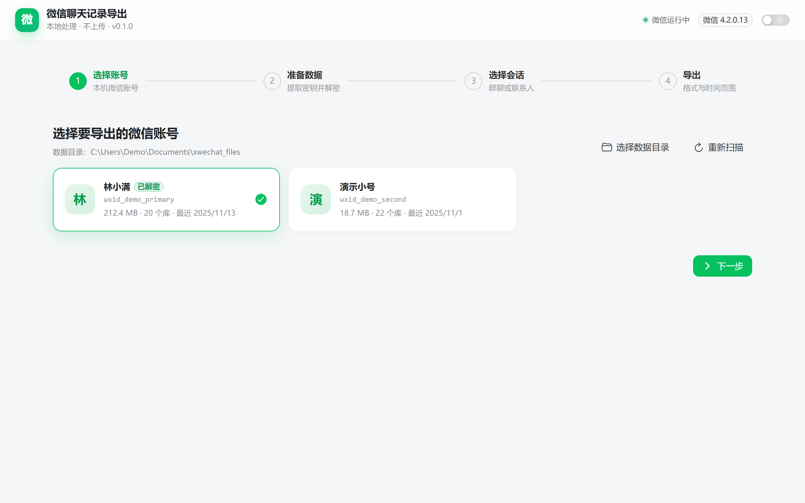
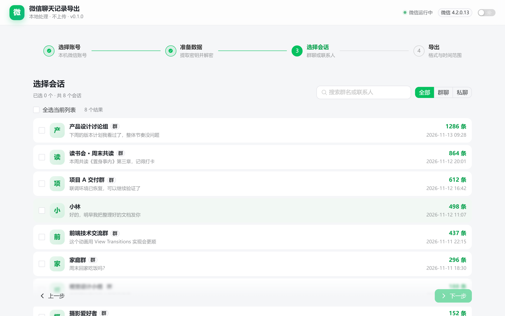
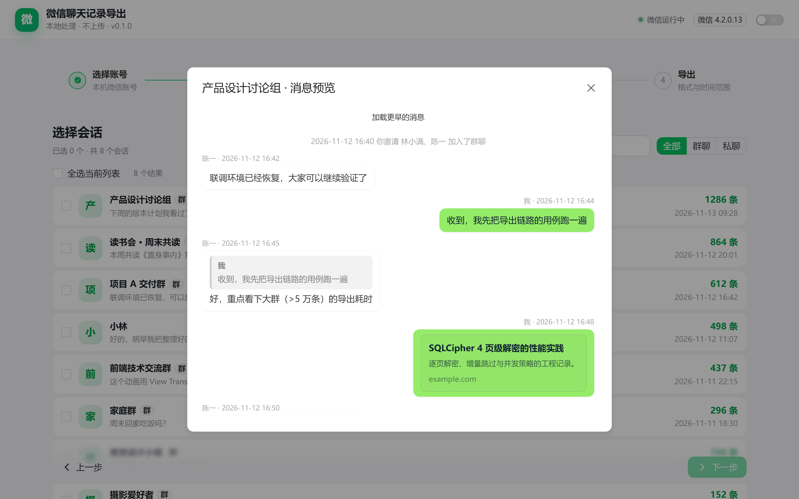
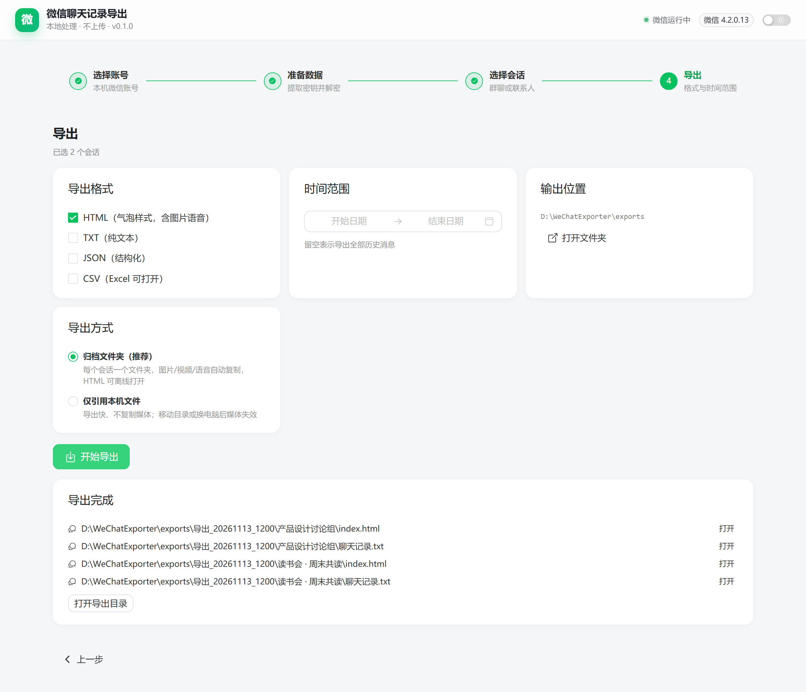

# 微信聊天记录导出（WeChat Exporter）


> 本地运行的微信 4.x 聊天记录导出工具：提取密钥 → 解密数据库 → 解密媒体 → 生成自包含归档。
> 所有处理只在本机完成，不联网、不上传。

---

## 功能特性

- **自动发现账号**：识别本机微信 4.x 数据目录与多个账号
- **密钥提取**：兼容微信 4.0.x（明文缓存）与 4.1.11+（`Config.Cipher` 掩码）两种形式
- **数据库解密**：SQLCipher 4 逐页解密，增量跳过未变化的库
- **富消息渲染**：引用、链接、文件、小程序、聊天记录（可展开明细）、转账、红包、拍一拍、接龙等
- **媒体处理**：
  - 图片：V2 `.dat` 解密、WxAM（`wxgf`）转 JPG
  - 语音：SILK v3 转 WAV
  - 视频：自动识别 HEVC 并转码为 H.264，保证浏览器可直接播放
- **自包含归档导出**：每个会话一个文件夹，`index.html` + `images/` + `videos/` + `audio/` + `manifest.json`，整个文件夹可移动、可离线打开
- **现代化界面**：Vue 3 + Naive UI，四步向导、深色模式、实时进度

---

## 界面预览

> 截图使用虚构演示数据，不含真实账号与聊天内容；完整截图（含深色模式）见 [docs/SCREENSHOTS.md](docs/SCREENSHOTS.md)。

| 选择账号 | 选择会话 |
|---|---|
|  |  |
| **消息预览（富消息渲染）** | **导出完成** |
|  |  |

---

## 环境要求

| 项目 | 要求 |
|---|---|
| 系统 | Windows 10 / 11（x64） |
| 微信 | 4.x，已登录并保持运行（密钥只存在于登录后的进程内存中） |
| Python | 3.11+（源码运行） |
| Node.js | 18+（构建前端） |
| WebView2 | Win11 自带；Win10 一般随 Edge 安装 |
| FFmpeg | 可选；用于 WxAM 转 JPG 与 HEVC 视频转码。需在 `PATH` 中，或在 `config.json` 配置 `ffmpeg` 路径 |

> 微信 3.x 不在支持范围内。

---

## 快速开始（源码运行）

```bash
# 1. 创建虚拟环境
python -m venv .venv
.venv\Scripts\pip install -r requirements.txt -i https://pypi.tuna.tsinghua.edu.cn/simple

# 2. 构建前端
cd webui
npm install --registry=https://registry.npmmirror.com
npm run build
cd ..

# 3. 启动（原生窗口）
.venv\Scripts\python run.py

# 或用默认浏览器打开
.venv\Scripts\python run.py --browser
```

前端开发模式：

```bash
# 终端 1：后端
.venv\Scripts\python -m uvicorn app.api.routes:create_app --factory --port 8765

# 终端 2：前端热更新（/api 代理到 8765）
cd webui && npm run dev
```

---

## 打包为可执行文件

```bash
.venv\Scripts\pip install pyinstaller
.venv\Scripts\pyinstaller packaging\app.spec
# 产物：dist\微信聊天记录导出\
```

> 打包体积约 150–250 MB（含 WebView2 加载器与 Python 运行时）。
> 如需分发 HEVC 转码能力，请同时提供 FFmpeg，并遵守其 LGPL/GPL 许可。

---

## 使用流程

1. **选择账号**：自动识别本机微信数据目录，选择要导出的账号
2. **准备数据**：依次「提取密钥 → 解密数据库 → 解密图片/语音/视频」
   - 首次媒体处理包含 HEVC 视频转码，耗时较长（取决于视频数量）
   - 二次执行会增量跳过，通常几秒完成
3. **选择会话**：搜索群名/备注，支持多选；点击会话可预览消息
4. **导出**：选择格式与时间范围，默认「归档文件夹」模式

---

## 导出结果结构

```
exports/
└── 导出_20261113_1200/
    ├── manifest.json                 # 批次清单
    └── 群聊名称/
        ├── index.html                # 聊天记录（相对路径，可离线打开）
        ├── 聊天记录.json              # 可选
        ├── 聊天记录.csv               # 可选
        ├── 聊天记录.txt               # 可选
        ├── images/                   # 图片（时间_哈希.ext）
        ├── videos/                   # 视频（H.264，可播放）
        ├── audio/                    # 语音 WAV
        └── manifest.json             # 会话清单与媒体统计
```

媒体复制优先使用**硬链接**（同盘不额外占空间），失败时自动回退为真实复制。

---

## 数据与隐私

| 内容 | 位置 |
|---|---|
| 配置 | `config.json` |
| 解密数据库 | `data\<账号>\` |
| 图片 / 语音 / 视频缓存 | `media\<账号>\` |
| 导出结果 | `exports\` |

- 程序不发起任何外网请求
- 原始微信数据只读，不会被修改
- 解密后的数据库、密钥文件和导出归档均包含敏感信息，请妥善保管
- 详见 [docs/PRIVACY.md](docs/PRIVACY.md)

---

## 兼容性

| 微信版本 | 密钥方式 | 状态 |
|---|---|---|
| 4.0.x | 内存明文 `x'<key><salt>'` | 理论支持，未广泛实测 |
| 4.1.11+ | `Config.Cipher` XOR 掩码 | 支持 |
| **4.2.0.13** | `Config.Cipher` XOR 掩码 | **已实测：20/20 库** |

微信升级可能导致密钥格式或加密参数变化。详见 [docs/COMPATIBILITY.md](docs/COMPATIBILITY.md)。

---

## 常见问题

**Q：视频有进度条但画面不动？**
视频可能是 HEVC（H.265）编码，浏览器默认不解码。请在第 2 步执行「解密图片/语音/视频」，程序会自动转码为 H.264；之后重新导出即可。

**Q：提示「未能提取到密钥」？**
请确认微信已登录并保持运行。密钥只存在于登录状态下的进程内存中。

**Q：解密的图片/视频缺失？**
微信只会在查看过之后缓存媒体文件。未缓存的内容会显示「未缓存到本地」占位，无法离线还原。

**Q：杀毒软件报毒？**
PyInstaller 产物可能被误报，属于常见现象。请添加信任，或直接使用源码运行。

---

## 项目结构

```
app/
  main.py              # pywebview + FastAPI 启动入口
  config.py            # 路径与配置
  api/routes.py        # HTTP 接口
  core/
    discovery.py       # 账号 / 目录 / 版本发现
    keys.py            # 密钥提取（两种策略）
    decrypt.py         # SQLCipher 解密
    media.py           # 图片 / 语音 / 视频转码
    message_parser.py  # 富消息解析
    export.py          # 会话解析与归档导出
    jobs.py            # 后台任务
webui/                 # Vue 3 + Naive UI 前端
packaging/app.spec     # PyInstaller 配置
tests/                 # 测试
tools/                 # 辅助脚本（界面截图等）
docs/                  # 架构、使用、开发文档
  screenshots/         # 界面截图（虚构演示数据）
```

---

## 开发与测试

```bash
# 富消息解析测试（离线，使用合成数据）
.venv\Scripts\python tests\test_parser.py

# 对真实数据库抽样验证
set WECHAT_EXPORTER_DB=D:\path\to\message_0.db
.venv\Scripts\python tests\test_parser.py
```

更多内容见 [docs/DEVELOPMENT.md](docs/DEVELOPMENT.md) 与 [docs/ARCHITECTURE.md](docs/ARCHITECTURE.md)。

---

## 贡献

欢迎提交 Issue 与 Pull Request，请先阅读 [CONTRIBUTING.md](CONTRIBUTING.md)。
提交前请确保：

- 不包含任何真实聊天记录、密钥、wxid、手机号等个人数据
- 新增解析类型附带合成数据测试
- 遵循现有代码风格

---

## 免责声明

- 本项目仅用于**导出本机、本人账号的聊天数据**，用于个人数据备份与研究
- 请勿用于访问他人数据或任何违法用途
- 本项目与腾讯公司无关，未获得其授权
- 使用本工具产生的任何后果由使用者自行承担；请遵守所在地法律法规及微信服务协议

---

## 致谢

- 密钥提取算法参考 [SmileGrassSky620/wechat-local-reader](https://github.com/SmileGrassSky620/wechat-local-reader)（MIT）
- V2 图片密钥推导思路参考 [qiaodogbear/ChatTrace](https://github.com/qiaodogbear/ChatTrace)（MIT）
- 依赖库：FastAPI、pywebview、PyCryptodome、zstandard、Pillow、pilk、PyAV、Vue 3、Naive UI
- 特别感谢上述开源项目的作者与社区

详见 [NOTICE.md](NOTICE.md)。

## License

[MIT](LICENSE) © 2026 TangGod991021
