# 界面截图

本页集中展示程序界面，方便前端与文档维护者快速了解布局、配色和交互。所有截图均使用**虚构演示数据**生成，不包含任何真实微信账号、会话或聊天内容。

界面基于 Vue 3 + Naive UI，主色 `#07c160`（微信绿），支持浅色 / 深色两种主题，采用五步向导：

1. 选择账号
2. 提取密钥
3. 选择会话
4. 准备数据（按所选会话解密）
5. 导出

---

## 1. 选择账号（浅色）

自动扫描本机微信 4.x 数据目录，展示账号昵称、wxid、数据体积、数据库数量与最近活跃时间。

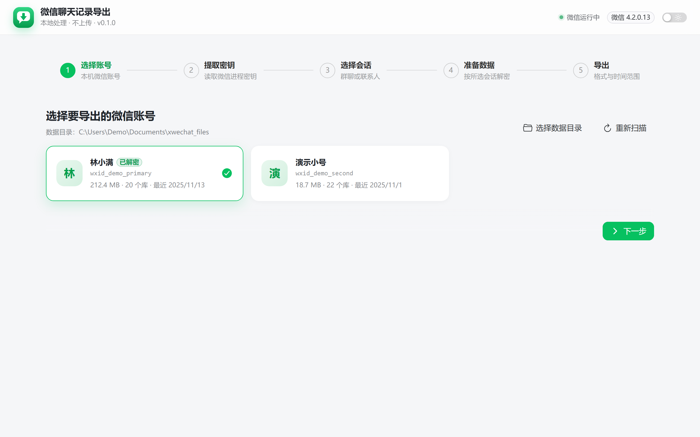

## 2. 提取密钥（浅色）

从运行中的微信进程提取 SQLCipher 密钥，并建立会话索引（`session.db` / `contact.db`）。完成本步后，后续步骤可离线执行。

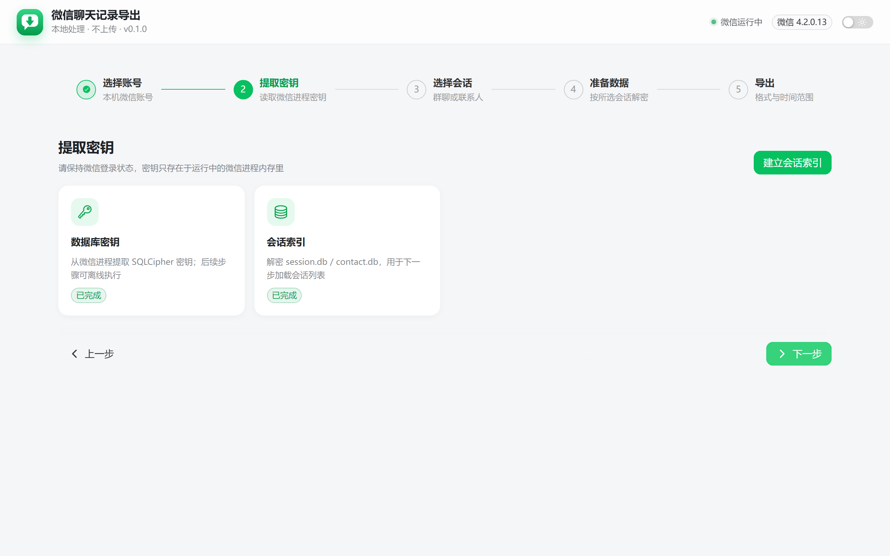

## 3. 选择会话（浅色）

支持搜索、按「全部 / 群聊 / 私聊」过滤、全选当前列表。进入本步时会自动解密消息库，因此可直接显示消息条数并预览聊天内容。

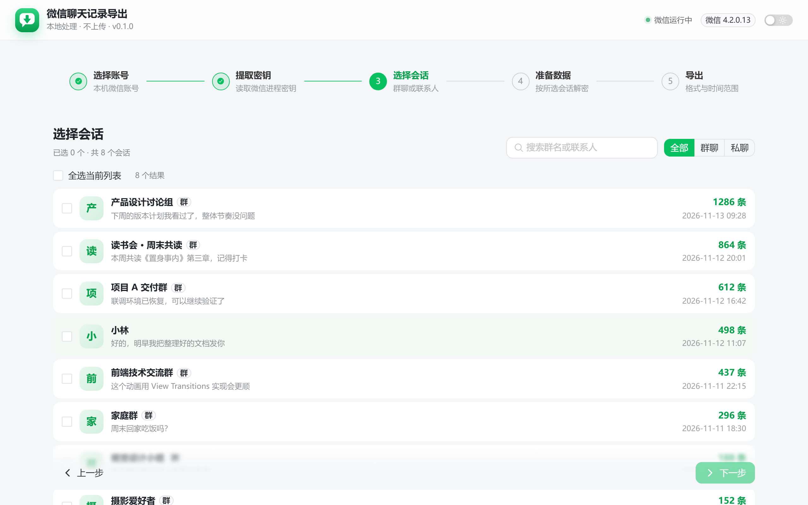

## 4. 消息预览（浅色）

点击会话打开预览。聊天气泡区分「我」与对方；支持引用、链接、文件、图片、转账、转发聊天记录等富消息类型。

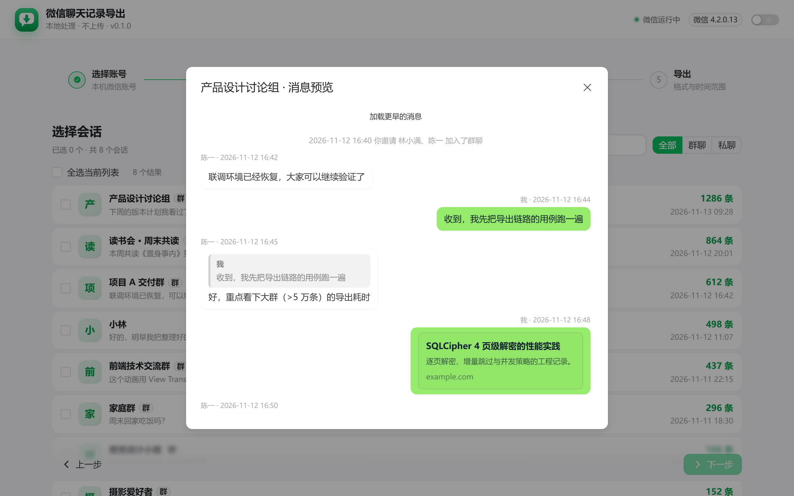

## 5. 转发聊天记录明细（浅色）

在预览中点击「聊天记录」卡片，可展开转发内容的消息明细。

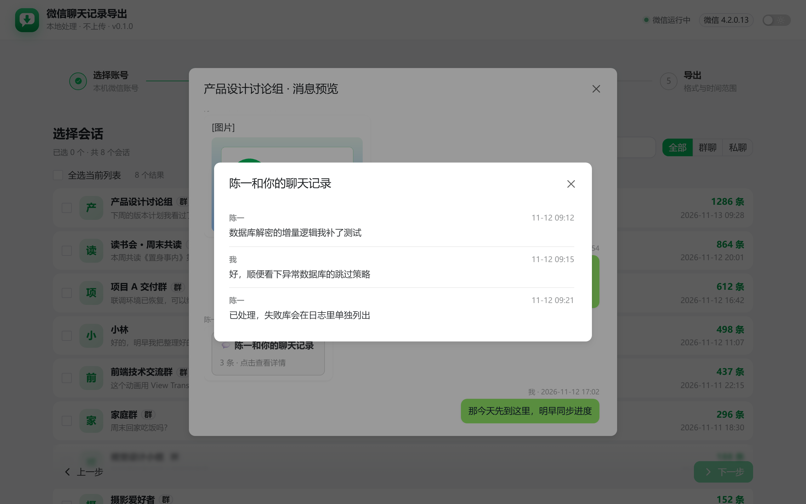

## 6. 准备所选数据（浅色）

只解密所选会话实际引用的图片 / 语音 / 视频，并转码其中的 HEVC 视频；不会处理未选中的会话。

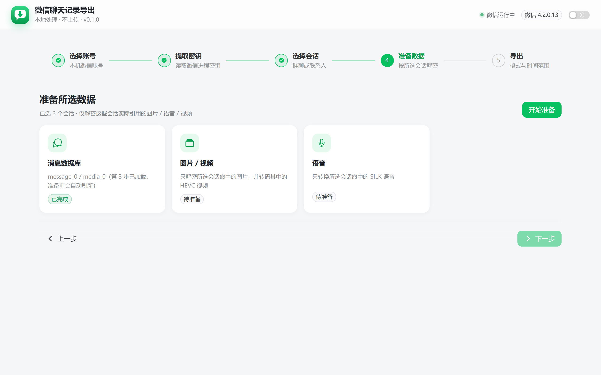

## 7. 准备进度（浅色）

分阶段展示解析会话、图片解密、语音转换、视频转码的进度与日志。

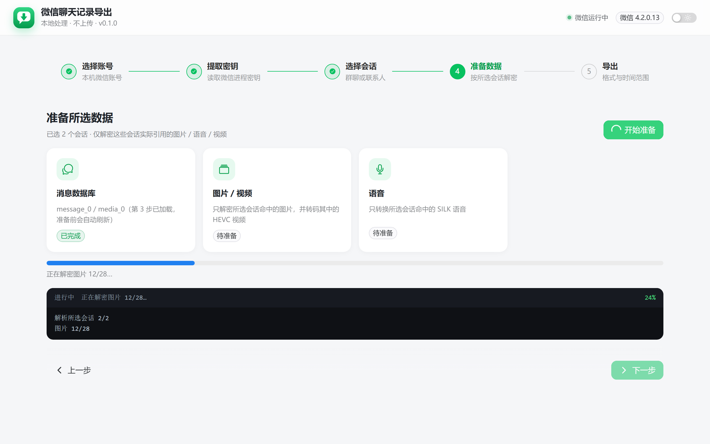

## 8. 准备完成（浅色）

三类数据均标记为已完成，可以进入导出。

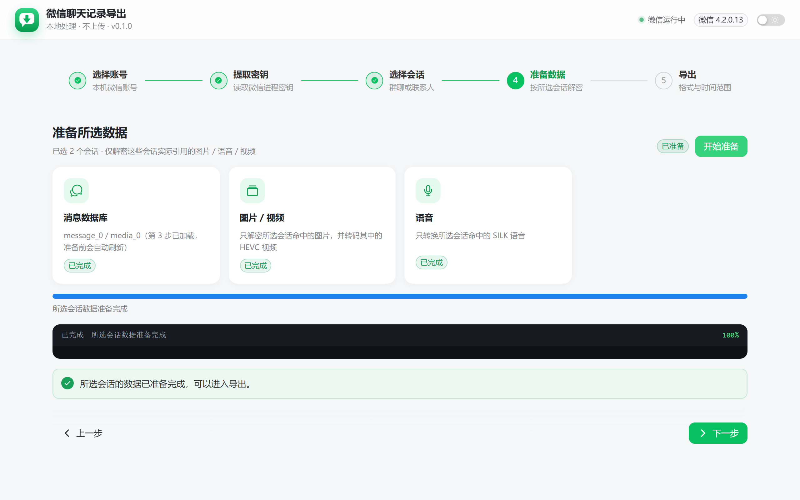

## 9. 导出设置（浅色）

选择导出格式（HTML / TXT / JSON / CSV）、时间范围、输出目录与导出方式（归档文件夹 / 仅引用本机文件）。

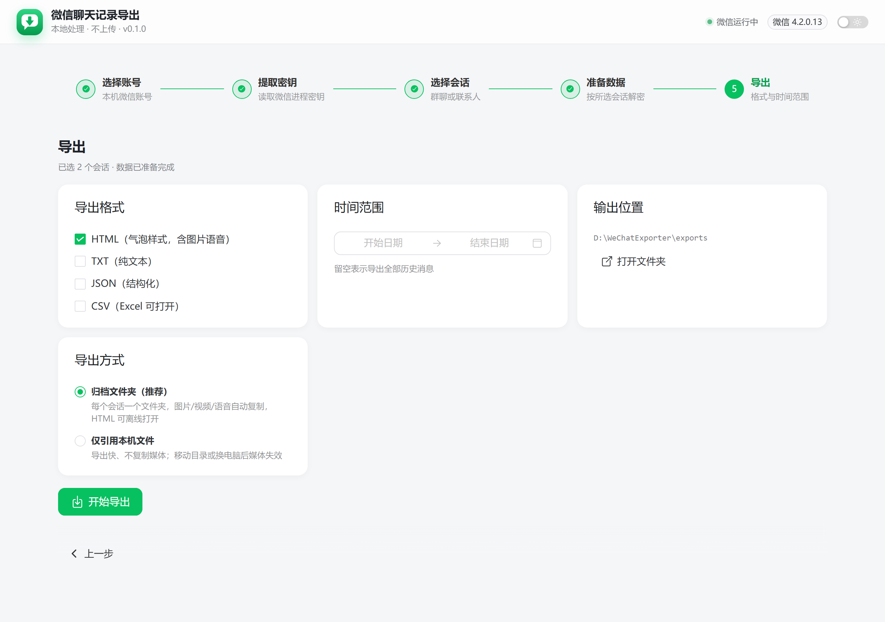

## 10. 导出进度（浅色）

导出过程中展示进度条与当前处理信息。

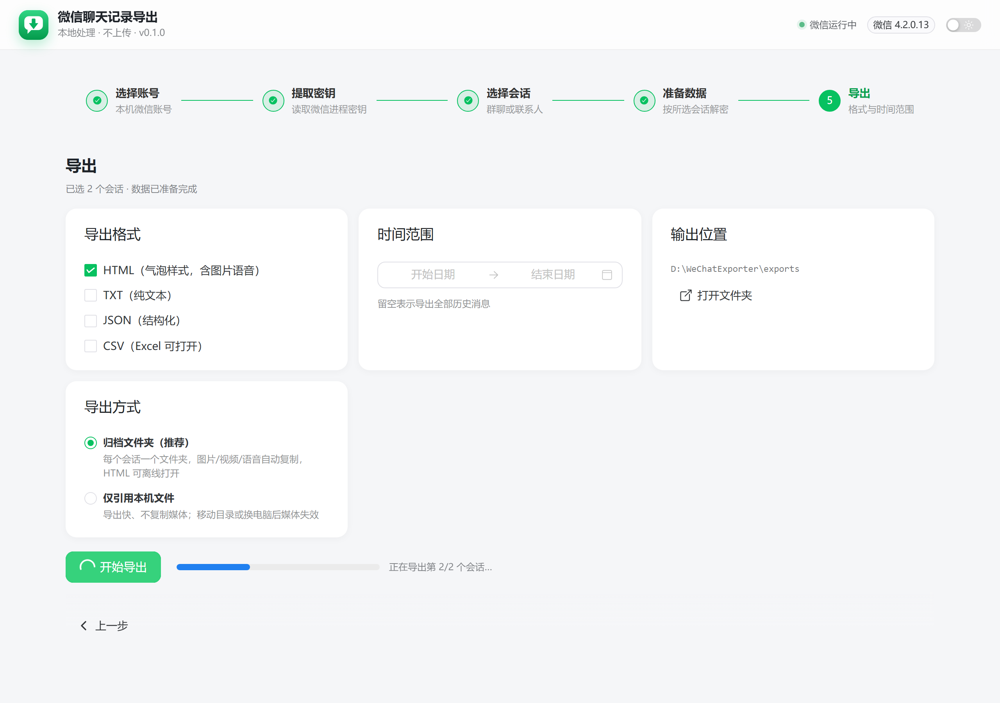

## 11. 导出完成（浅色）

完成后列出生成的文件，可逐个打开或直接打开导出目录。

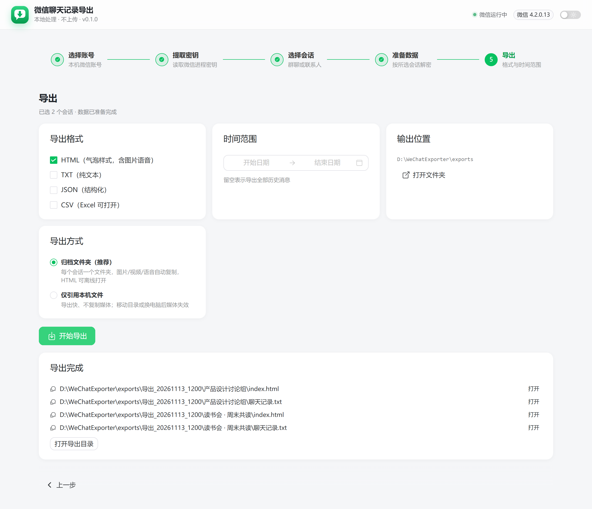

## 12. 导出完成（深色）

深色模式下的导出页，配色随主题切换。

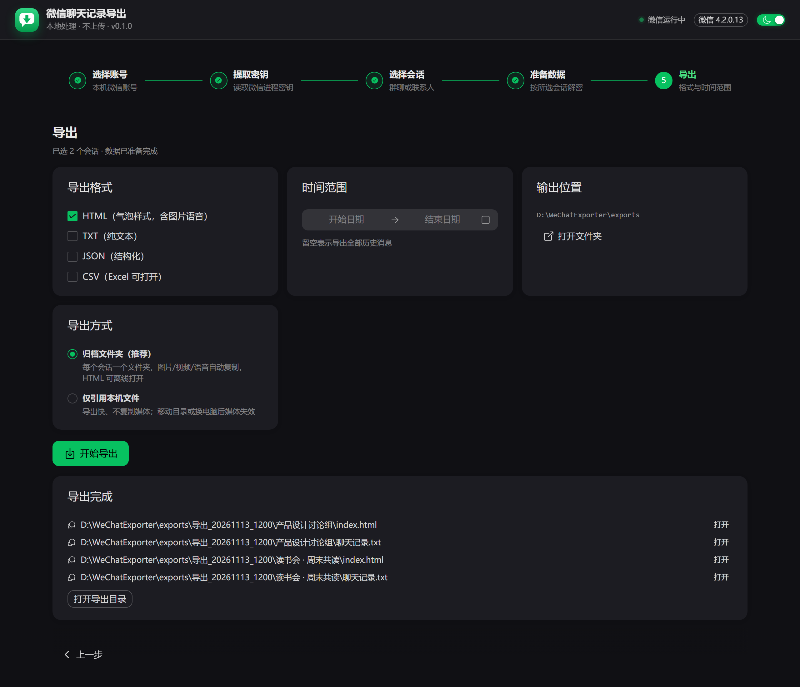

## 13. 选择会话（深色）

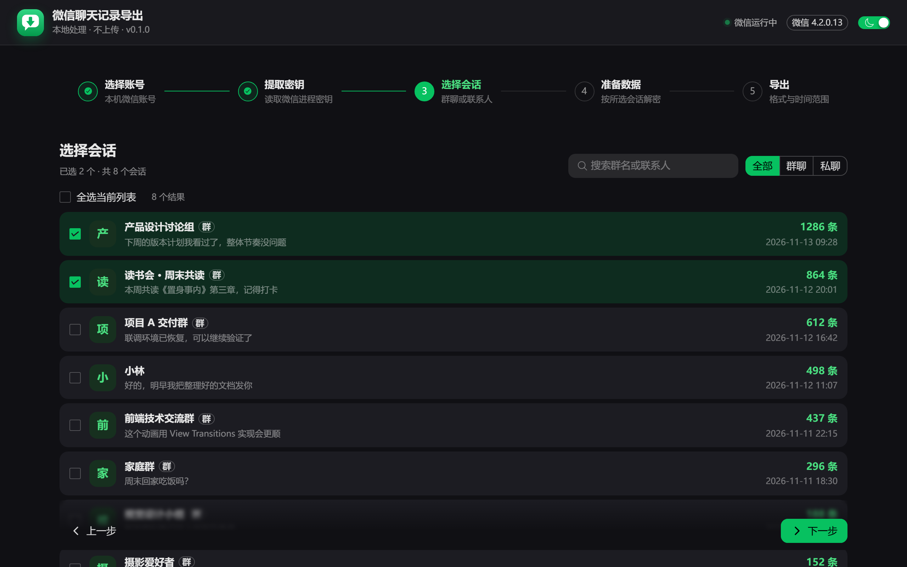

## 14. 消息预览（深色）

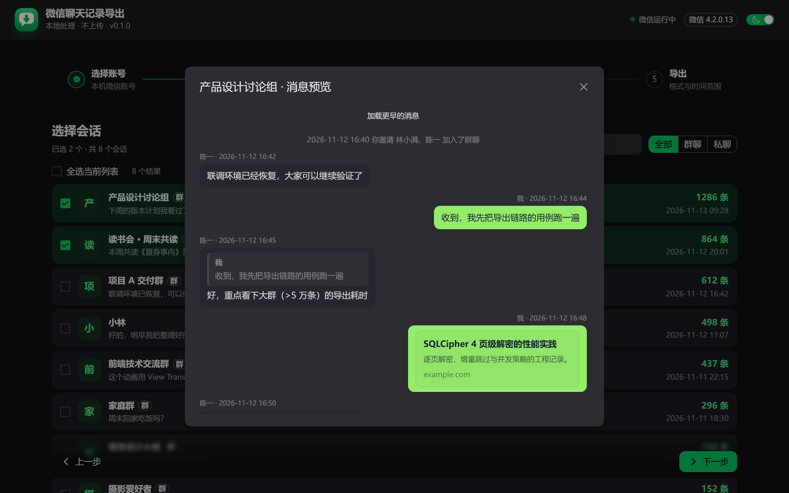

---

## 重新生成截图

截图由脚本自动生成，接口数据全部在脚本内模拟：

```bash
# 1. 构建前端（webui/dist）
cd webui && npm run build && cd ..

# 2. 安装 Playwright（仅首次）
pip install playwright
playwright install chromium

# 3. 生成到 docs/screenshots/
python tools/capture_screenshots.py
```

脚本说明见 [`tools/capture_screenshots.py`](../tools/capture_screenshots.py)。修改界面后请重新运行，保持截图与代码一致。
